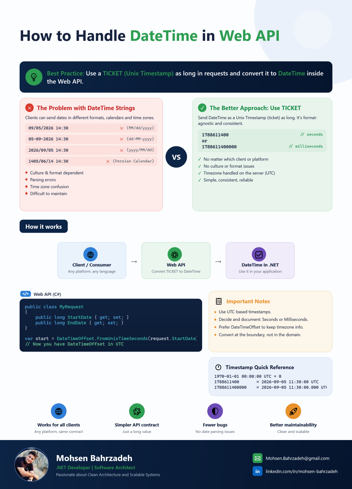
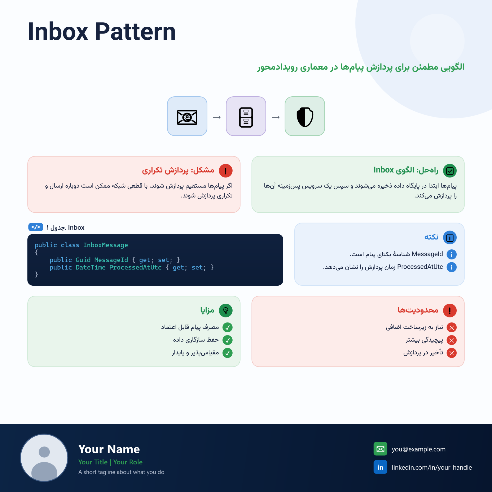
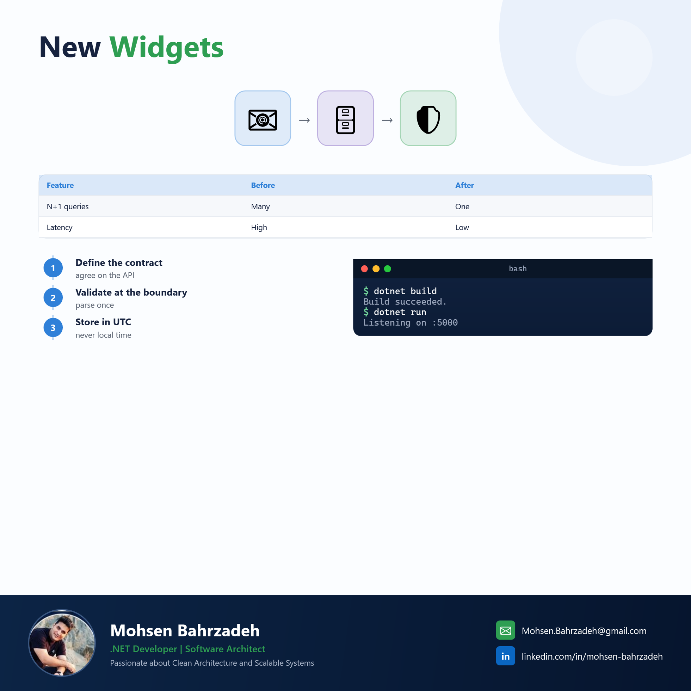
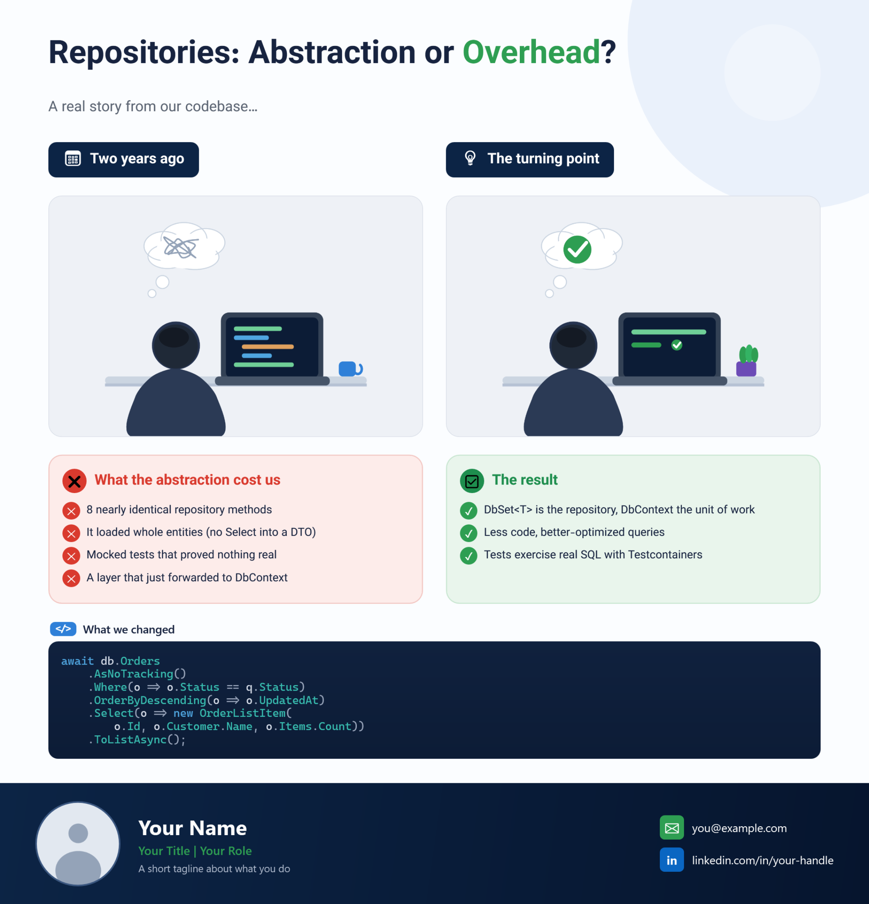

# LinkedIn Post Studio

A Windows desktop app (**WPF, .NET 10**) for building LinkedIn infographic posts. Drag ready‑made
widgets onto a canvas, edit their text / code / images, and export a pixel‑perfect PNG — with
**automatic right‑to‑left (Persian) and left‑to‑right (English) text** so mixed‑language posts always
read correctly. A locked footer carries your name, photo and contacts on every slide.



## Why
Hand‑placing content into a template (or asking an AI to do it) kept producing spelling mistakes and
broken direction — Persian not right‑aligned, English not left‑aligned. This tool fixes that at the source:

- **Automatic text direction** per widget — Persian → RTL, English → LTR, with correct bidi so embedded
  terms like `Web API` / `DateTime` stay LTR inside a Persian sentence.
- **You type the text yourself** in a proper editor (no transcription errors).
- **Consistent brand styling** baked into every widget, so your posts always look the same.

## Gallery
| Persian / English infographic | Widgets |
| --- | --- |
|  |  |

Mix the structured widgets with your own illustrations — drop any PNG onto the canvas with the **Image**
widget, while the code and text stay accurate and editable:



The footer is yours and is set once (see **Your footer / profile**):


> Example specs for these posts live in [`posts/specs`](posts/specs) (EN + FA), with the illustrations in
> [`posts/assets/illustrations`](posts/assets/illustrations). Render them from the repo root with
> `--spec posts/specs/05-repositories-hybrid-en.json --out posts/out`.

## Features
- **Canvas designer**: click a widget to add it, drag to move, handles to resize, with **snapping +
  alignment guides** to the canvas centre, margins and other items. A red **✕** on the selected item
  (and a trash button in the Layers tab) deletes it.
- **26 ready‑made widgets**: Title (two‑tone), Banner, Section label, Problem box, Solution box,
  Custom box (free colours + bullet markers: check / cross / info / dot / number), Code block
  (C#/JSON highlighting + `</>` badge), Terminal, Notes, Reference, Checklist, Flow (with icons),
  Steps (vertical), Benefits row, Table, Stat / KPI, Progress bar, Quote, Header graphic (icons + arrows),
  Text, Tag / Pill, Icon, Image, VS badge, Divider, Arrow.
- **Layers panel**: reorder, rename, show/hide and lock every element.
- **Undo / Redo**, copy / paste, duplicate, and arrow‑key nudging (Shift = 10px).
- **Bigger / smaller text** on any text widget with the **A− / A+** buttons or **Ctrl + / Ctrl −**
  (for boxes it scales all the text inside proportionally).
- **Colour picker** (swatches + hex) and **font picker**; per‑item **opacity** and **rotation**.
- **Your footer / profile** — the footer is editable from the UI (click empty canvas → *Footer & Canvas*),
  and **Save as my default profile** stores your name/photo/contacts locally so every new post starts with
  your footer. The repository ships a neutral placeholder, so your details never live in the code.
- **Bilingual UI** (فارسی / English) — toggle at runtime; the whole app flips to RTL for Persian.
- **Custom canvas size** (default 1080×1500) plus Portrait / Square presets and a canvas background colour.
- **Save / Open** projects as `.lipost` (JSON) and **Export** to high‑resolution PNG (2× scale).
- **Fit height / Fit all**: sizes a widget to what its content needs; *Fit all* also trims the canvas to end
  just above the footer.
- **Post text (caption)**: type the LinkedIn text + hashtags in the *Footer & Canvas* panel; Export saves it
  as a `.txt` next to the PNG, ready to paste.
- **Spec files** + **carousel PDF**: describe a post as rows of widgets (no coordinates) and batch‑build many
  posts, optionally bundled into one PDF (see *Authoring posts from a spec*).

## Keyboard shortcuts
| Action | Keys |
| --- | --- |
| Undo / Redo | Ctrl+Z / Ctrl+Y |
| Duplicate | Ctrl+D |
| Copy / Paste | Ctrl+C / Ctrl+V |
| Delete | Del |
| Nudge selection | Arrow keys (Shift = 10px) |
| Text bigger / smaller | Ctrl+ +  /  Ctrl+ − |

## Requirements
- Windows 10/11
- [.NET 10 SDK](https://dotnet.microsoft.com/download) (Windows Desktop) — only to build/run from source.

## Download & run
**From source:**
```bash
dotnet run --project src/LinkedInStudio/LinkedInStudio.csproj
```

**Build a standalone .exe** (no SDK needed to run it afterwards):
```bash
dotnet publish src/LinkedInStudio/LinkedInStudio.csproj -c Release -r win-x64 --self-contained true -p:PublishSingleFile=true
```
The single file lands in `bin/Release/net10.0-windows/win-x64/publish/`.

## Your footer / profile
The committed default footer is a neutral placeholder (*Your Name*, a silhouette avatar). To make it yours:
1. Run the app, click an empty part of the canvas to open **Footer & Canvas**.
2. Fill in your name, role, tagline, email, LinkedIn and choose your photo.
3. Click **Save as my default profile**.

Your profile is stored at `%AppData%/LinkedInStudio/profile.json` (outside the repo), and every new post
starts with it automatically.

## Headless / batch export
```bash
# one project (or spec) → PNG
dotnet run --project src/LinkedInStudio/LinkedInStudio.csproj -- --render out.png --in my-post.lipost

# many posts from specs (files, wildcards or a folder), optional carousel PDF
LinkedInStudio.exe --spec posts\specs --out posts\out --pdf carousel.pdf
```
For every input it writes `<id>.png`, `<id>.lipost` (re‑openable), `<id>.txt` (the caption, if any) and a
`build.log` with sizes and layout warnings. `--scale 1.5` changes the PNG scale (default 2).

## Authoring posts from a spec
A spec is a small JSON file: a list of **rows**, each row holding one or more widgets — no coordinates.
The builder splits each row into columns, measures every widget's real height (so wrapped Persian/English
text never overflows), makes sibling boxes equal height, and sizes the canvas to fit.

```json
{
  "id": "inbox",
  "rows": [
    { "kind": "title", "text": "Inbox Pattern" },
    { "kind": "scene", "nodesText": ["📧 | #2F80D8", "🗄️ | #6C4BB6", "🛡️ | #2E9E52"] },
    { "items": [
      { "kind": "custombox", "span": 1, "header": "Problem", "glyph": "❗", "marker": "None",
        "body": "Processing a message directly can double‑process it on a retry." },
      { "kind": "custombox", "span": 1, "header": "Solution", "glyph": "✅", "marker": "CheckCircle",
        "bulletsText": ["Store first", "Process in the background", "Idempotent by MessageId"] } ] },
    { "kind": "code", "caption": "Inbox table", "showBadge": true,
      "code": "public class InboxMessage { public Guid MessageId { get; set; } }" }
  ]
}
```
- `kind` is any widget (see the feature list). Other property names are the widget's own properties
  (case‑insensitive). Aliases: `list`→checklist, `kpi`→stat, `tag`→pill, `label`→section, `hook`→banner.
- Any multi‑line text property can be written as a JSON array of strings (one per line).
- Row options: `"vs": true` puts a VS badge between the first two widgets; `"colGap"`, `"before"` adjust spacing.
  Widget options: `"span"` (relative width) and `"height"` (fix instead of measuring).
- Top‑level: `width`, `margin`, `gap`, `minHeight`, `height`, `background`, `caption`, and `footer`.

## Editing tips
- In Title/Banner text, wrap a phrase in `*asterisks*` to render it in the green highlight colour,
  e.g. `How to Handle *DateTime* in *Web API*`.
- List widgets use one item per line; use `|` to split parts, e.g. `1788611400 | // seconds`.
- Flow / Benefits / Header‑graphic accept an icon part, e.g. `Web API | Convert | ⚙️` or `📧 | #2F80D8`.

## Project layout
```
src/LinkedInStudio/
  Assets/profile.png          placeholder footer avatar (yours stays in %AppData%)
  Infrastructure/             MVVM base, text‑direction, syntax highlighter, converters
  Localization/Localizer.cs   fa / en strings
  Models/                     DocumentModel + widget item models (JSON‑serializable)
  ViewModels/                 EditorViewModel (palette, commands, starter layout)
  Services/                   DocumentStore, ExportService, LayoutService, SpecBuilder, PdfWriter,
                              ProfileStore (your footer), HeadlessRunner (CLI)
  Themes/                     DesignTokens, WidgetTemplates (visuals), EditorTemplates (property editors)
  Controls/                   DesignerSurface (canvas), ColorPicker
  MainWindow                  toolbar, palette, properties panel
```

## Notes
- *Auto* direction follows the script that dominates the widget's text, so a Persian sentence starting with
  an English term still flows RTL.
- Persian rendering looks best with the **Vazirmatn** font installed; otherwise it falls back to
  Segoe UI / Tahoma.
- No telemetry, no network calls — everything runs locally.

## Contributing
Issues and pull requests are welcome. Please keep the design‑token system (colours/fonts in
`Themes/DesignTokens.xaml`) consistent and add new widgets as a model + `V.*` template + `E.*` editor.

## License
[MIT](LICENSE) © Mohsen Bahrzadeh

## Author
**Mohsen Bahrzadeh** — .NET Developer | Software Architect
[linkedin.com/in/mohsen-bahrzadeh](https://linkedin.com/in/mohsen-bahrzadeh) · Mohsen.Bahrzadeh@gmail.com
